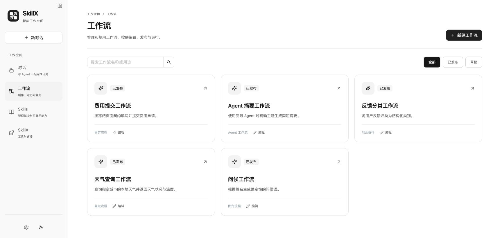
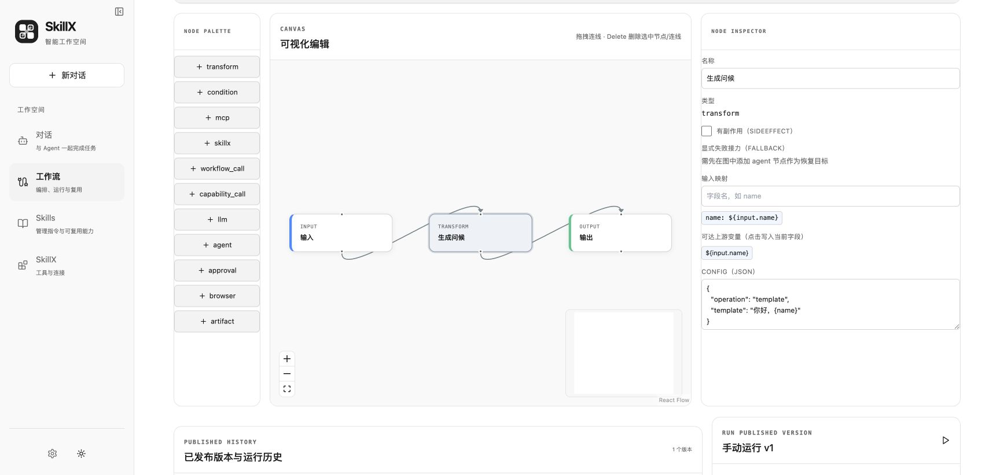
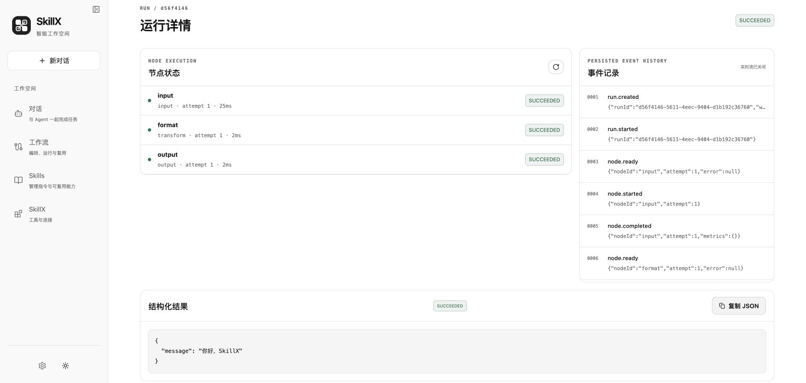

# SkillX

**把 Agent 探索出的做法，变成可复用、可持久执行的工作流。**

[English](README.en.md) · [贡献指南](CONTRIBUTING.md) · [安全说明](SECURITY.md) · [MIT 许可](LICENSE)

SkillX 是一个本地优先的 AI 工作空间，把对话、Agent、技能和可视化工作流连接起来。
你可以先用自然语言完成任务，再把稳定做法沉淀为带版本的能力，由独立 Worker 执行，
并通过人工审批、检查点和执行轨迹管理运行过程。

项目仍在积极开发，当前界面及主要设计文档为中文。适用于受信任的单用户本地环境，
尚不适合直接作为公网服务或多租户平台部署。

## 主要能力

- **对话与模型服务**：配置 OpenAI 兼容服务，使用默认 Pi Agent；兼容模型支持图片输入、推理强度与用量统计。
- **可视化工作流**：拖放节点、映射输入、校验图结构，发布不可变版本并锁定依赖。
- **能力复用**：工作流、SkillX 包、LLM、Agent 和 MCP 工具使用统一调用契约。
- **持久执行与恢复**：SQLite 队列、独立 Worker、人工交互卡片、取消、重试和失败接力。
- **轨迹与技能管理**：查看模型请求和返回，管理技能内容及版本。

自动固化只覆盖可验证的受支持场景；任意生成代码和新副作用仍需审核。
MCP Streamable HTTP 等实现限制见[能力状态](docs/capability-status.md)。



## 快速开始

需要 Python **3.12–3.13**、[uv](https://docs.astral.sh/uv/getting-started/installation/)、
Node.js **22.19+**、npm 和 Git。启动脚本适用于 macOS / Linux；Windows 请使用 WSL。

克隆仓库并启动：

```bash
git clone https://github.com/zaoweiceng/skillx.git
cd skillx
./dev.sh
```

脚本安装锁定的依赖和 Chromium，执行数据库迁移及示例初始化，然后启动 API、Worker 和前端。

- 工作空间：<http://127.0.0.1:5173>
- API 文档：<http://127.0.0.1:8000/docs>
- 本地日志：`.dev/logs/`

打开「设置 → 模型服务与 Agent」，添加服务 Base URL、API Key 和模型，测试连接后即可使用 Pi 对话。
模型调用使用你自己的服务账号，可能产生费用。浏览界面和运行 fixture 测试不需要模型密钥。
按 `Ctrl+C` 停止全部服务；后端变更后重启脚本，前端支持热更新。

```bash
./dev.sh --setup-only                     # 仅安装和初始化
./dev.sh --skip-install                   # 已有依赖时跳过安装
API_PORT=8001 FRONTEND_PORT=5174 ./dev.sh  # 自定义本地端口
```

正常升级会执行增量迁移，不需要重置数据库。升级前请备份本地数据。
`./dev.sh --reset-db` 仅用于不兼容旧数据库的破坏性重建，会删除历史数据和已发布版本，
不要把它当成正常安装或升级步骤。

## 运行第一个示例

不配置模型服务，也可以先运行内置的「问候工作流」体验完整流程：

1. 在「工作流」列表找到「问候工作流」，点击「编辑」。
2. 点击「生成问候」节点，查看输入映射和模板；画布支持拖放节点与连线。
3. 在页面下方「手动运行 v1」输入姓名，例如 `SkillX`，点击「启动已发布版本」。
4. 在运行详情查看节点状态、事件记录和结果 `你好，SkillX`。这个示例不调用模型。

编辑草稿不会改变已发布版本。需要让修改生效时，保存草稿、执行静态检查，再发布新版本。





## 配置与安全边界

默认不需要 `.env`。需要修改配置时，把 `backend/.env.example` 复制为 `backend/.env`。
API 和 Worker 必须共用数据库、Artifact 路径与凭据目录。通过启动脚本运行时，下列相对路径以 `backend/` 为基准。

| 配置项 | 用途与默认值 |
| --- | --- |
| `SKILLX_DATABASE_URL` | SQLite 数据库，`sqlite+aiosqlite:///./skillx.db` |
| `SKILLX_ARTIFACT_ROOT` | 本地产物，`./artifacts` |
| `SKILLX_CAPABILITY_ROOT` | 可信 SkillX 包，`../capabilities/skillx` |
| `SKILLX_RUNTIME_CREDENTIALS_PATH` | 模型密钥文件，`./.runtime-credentials` |
| `SKILLX_AGENT_RUNTIME_TYPE` | 示例配置使用 `pi`；默认安装项目内 Pi SDK |
| `SKILLX_AUTO_CREATE_SCHEMA` | 保持 `false`，通过 Alembic 迁移管理数据库 |

高级运行时、直接 LLM 和失败接力配置见[运行时适配器](docs/runtime-adapters.md)。

模型密钥保存在 `backend/.runtime-credentials/` 的受限文件中，数据库只保存引用，
但密钥文件并未加密。对话、图片、轨迹和 Artifact 也可能包含敏感信息，不能提交到 Git。
API 没有用户认证层，请保持默认仅监听本机。只安装可信技能和工具，Python venv 不是安全沙箱。

## 开发与验证

先执行 `./dev.sh --setup-only` 安装开发依赖，再运行：

```bash
make quality-check
make demo-check
make browser-ui-check
```

浏览器测试需要 Chromium，可通过 `make browser-install` 单独安装。
真实 TraeX 测试是可选项，需要本机安装并登录；fixture 通过不等于真实模型服务验证通过。

## 架构与目录

React 工作空间通过 REST / SSE 连接 FastAPI。SQLite 保存工作流版本和执行状态，
独立 Worker 调用 SkillX、LLM、Agent、MCP 或浏览器执行任务。
Host 校验契约、权限和执行预算；已发布版本和已锁定依赖保持不可变。

```text
backend/       API、领域契约、编排、Worker、迁移与测试
frontend/      对话、设置、执行轨迹与可视化编辑器
bridges/pi/    项目内 Pi SDK 适配桥
capabilities/  可移植 SkillX 示例包
examples/      工作流与本地集成示例
docs/          规范、使用说明与截图
tools/         开发与文档检查工具
```

## 文档

- [能力状态与实现边界](docs/capability-status.md)
- [任务生命周期与人工交互](docs/task-runtime.md)
- [运行时适配器与恢复](docs/runtime-adapters.md)
- [SkillX 包规范](docs/skillx.md)
- [Skills 管理](docs/managed-skills.md)
- [数据库结构](docs/schema.md)
- [产品设计](docs/workflow-design-doc.md)与[开发说明](docs/workflow-dev-doc.md)
- [演示验收场景](docs/demo-acceptance.md)

## 贡献与许可

贡献请遵循 [CONTRIBUTING.md](CONTRIBUTING.md)；漏洞请按 [SECURITY.md](SECURITY.md) 私下报告。
`STEP/`、`REPLAY/` 和 `review/` 为历史设计与验收记录，结论仅对应记录中的版本和日期。

Copyright © 2026 zaoweiceng。采用 [MIT License](LICENSE)；第三方依赖保留各自许可证。
