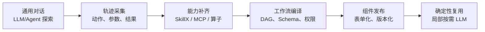
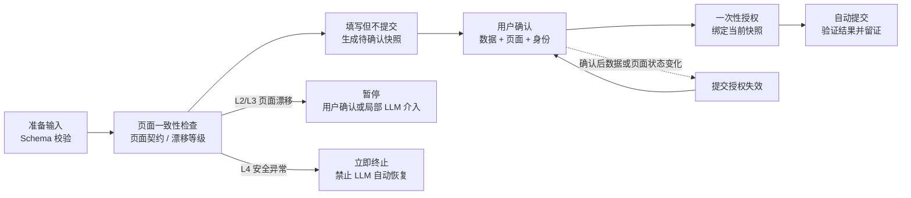
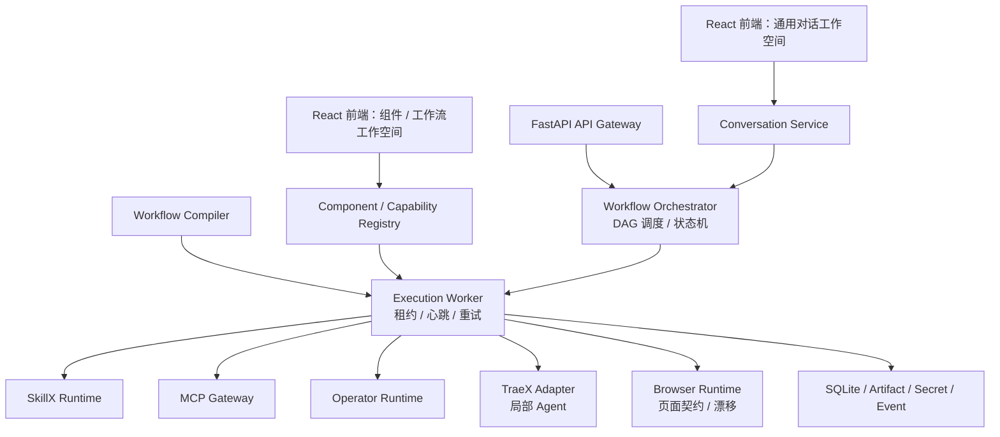

# SkillX 可视化工作流平台设计文档
产品设计、能力模型、执行语义与系统架构

| 文档版本 | v0.1                          |
|----------|-------------------------------|
| 文档状态 | 研发基线稿                    |
| 编制日期 | 2026-08-03                    |
| 适用范围 | SkillX / MCP 可视化工作流平台 |

**核心定位：首次任务由 Agent 探索，重复任务编译为持久化工作流；模型只在必要节点介入。**

# 目录

**1. 文档目的与结论**

**2. 背景、目标与范围**

**3. 产品模型与核心闭环**

**4. 用户角色与典型场景**

**5. 前端信息架构与交互**

**6. 执行模型与工作流语义**

**7. SkillX 能力规范**

**8. MCP、算子与能力分层**

**9. 浏览器任务固化与安全提交**

**10. 系统总体架构**

**11. 数据、版本与状态模型**

**12. 安全、权限与治理**

**13. 可观测性与非功能要求**

**14. MVP 范围与演进路线**

**15. 风险、默认假设与待确认项**

# 1. 文档目的与结论

本文定义 SkillX 可视化工作流平台的产品边界、用户体验、能力模型、执行语义和总体架构，作为需求评审、技术设计和研发拆解的统一基线。

| **核心结论**                                                                                                                                                                                                                   |
|--------------------------------------------------------------------------------------------------------------------------------------------------------------------------------------------------------------------------------|
| 平台不是“把 Agent 对话画成流程图”，而是将一次成功的动态 Agent 执行编译成具有固定输入、确定节点、明确权限和稳定输出的持久化工作流。对话页默认由 LLM/Agent 主导；组件页默认由工作流引擎主导；模型只在显式的 LLM/Agent 节点介入。 |

- 已知流程不重复规划：固定的 Tool、节点顺序和参数映射由工作流引擎直接执行。

- 未知流程先探索后固化：TraeX 完成首次任务并记录结构化轨迹，系统提炼为组件。

- SkillX 兼容现有 Skill：保留面向 LLM 的指南入口，并增加可供工作流调用的契约化接口。

- 浏览器写操作遵循“页面校验—填写—用户确认—一次性授权—提交—验证”的闭环。

- 工作流执行器独立于 Agent Loop，TraeX 只作为局部 Agent Runtime。

# 2. 背景、目标与范围

## 2.1 背景问题

用户经常重复执行由若干 Skill、MCP Tool、浏览器操作和数据转换组成的长任务。虽然每次输入不同，但任务结构、工具集合和输出格式通常稳定。若每次都由 LLM 重新理解意图、发现工具、规划步骤并生成参数，会产生额外 Token、延迟、结果波动和失败恢复成本。

## 2.2 建设目标

- 提供通用对话工作空间，支持 LLM/Agent 完成尚未固化的任务。

- 提供组件工作空间，用户通过结构化表单直接运行已发布工作流。

- 支持将成功的 Agent 轨迹转换为可编辑、可测试、可发布的工作流草稿。

- 支持 Skill、SkillX、MCP、确定性算子和子流程的统一注册、版本化与可视化。

- 支持零 LLM、局部 LLM 和受限 Agent 三类执行方式。

- 支持长任务持久化、取消、重试、恢复、审批和完整审计。

- 通过契约和版本锁定提升执行稳定性，并统计固化前后的成本与耗时变化。

## 2.3 非目标

- 第一阶段不建设通用 BPMN 平台或全功能低代码系统。

- 第一阶段不允许任意用户上传不可信代码后直接在宿主机运行。

- 第一阶段不追求多 Agent 自由协商或自动生成任意复杂 MCP。

- 第一阶段不自动发布由 Agent 生成的 SkillX、MCP 或工作流。

- 第一阶段不以多集群、高并发云原生调度为目标。

# 3. 产品模型与核心闭环



*图 1 对话探索、能力补齐、工作流编译与组件复用闭环*

## 3.1 两个工作空间

| **工作空间** | **默认执行主体** | **输入方式**               | **主要用途**                             |
|--------------|------------------|----------------------------|------------------------------------------|
| 通用对话     | LLM / Agent      | 自然语言、文件、URL、ID    | 完成新任务、理解意图、调用组件、探索流程 |
| 组件与工作流 | Workflow Runtime | JSON Schema 表单、确认动作 | 稳定复用、零/局部 LLM 执行、审计与调试   |

## 3.2 通用对话行为

- 通用输入框默认与 LLM 交互。用户仅输入“成都”时，由 LLM 结合当前上下文判断意图，而不是由静态路由直接调用天气工作流。

- 当 LLM 判断已有组件适合当前任务时，负责匹配组件、提取参数、补齐缺失输入；组件启动后由工作流引擎接管。

- 对话可以显式绑定组件上下文。绑定状态必须可见且可退出，避免用户不知道输入正被哪一组件解释。

- 任务成功后，用户可主动发起“固化为组件”；系统不得在用户不知情的情况下自动发布。

## 3.3 组件工作空间行为

- 组件页顶部展示业务视图与技术视图两级 DAG。业务视图按业务步骤聚合，技术视图展示 SkillX、MCP、LLM、Agent、浏览器和算子节点。

- 组件输入由 Input Schema 与 UI Schema 生成，提交后直接加载锁定的工作流版本。

- 已发布工作流不进入通用 Agent Planner；仅在节点配置明确允许时调用 LLM 或 Agent。

- 执行过程中实时展示节点状态、输入输出摘要、依赖版本、Token、耗时、日志和 Artifact。

# 4. 用户角色与典型场景

## 4.1 角色

| **角色**   | **核心权限**                                     | **限制**                            |
|------------|--------------------------------------------------|-------------------------------------|
| 普通用户   | 对话、运行组件、查看自己的执行记录、发起固化请求 | 不能发布公共能力或修改高风险权限    |
| 组件作者   | 编辑工作流、配置表单、测试、提交发布             | 不能直接管理 Secret 或越权绑定 Tool |
| 能力开发者 | 创建/修改 SkillX、MCP、算子并执行测试            | 生成结果需审核后发布                |
| 发布审核者 | 审核能力与组件版本、确认副作用和兼容性           | 不得绕过安全门禁                    |
| 管理员     | 管理模型、Secret、执行环境、RBAC、审计           | 高风险操作需保留审计记录            |

## 4.2 典型场景

| **场景**            | **首次执行**                   | **固化后执行**                            | **LLM 范围**       |
|---------------------|--------------------------------|-------------------------------------------|--------------------|
| 天气查询            | 可由 LLM 识别意图并选择能力    | 输入城市，直接调用天气 MCP/Direct SkillX  | 零 LLM             |
| 网站表单提交        | Agent 探索页面并完成一次任务   | 输入/确认字段，浏览器运行时按契约重放     | 页面漂移时局部介入 |
| 投诉处理            | Agent 读取投诉、判断类别并回写 | 固定读取与回写，中间分类/生成节点使用 LLM | 两个局部 LLM 节点  |
| JSON 筛选并导出 CSV | Agent 或人工建立步骤           | 确定性算子直接执行                        | 零 LLM             |
| 新业务系统自动化    | TraeX 开发 MCP/SkillX 草稿     | 发布后由工作流复用                        | 开发阶段使用 Agent |

# 5. 前端信息架构与交互

## 5.1 导航结构

```text
平台
├── 对话
│   ├── 新对话 / 历史对话
│   ├── Agent 执行轨迹
│   └── 固化为组件
├── 组件
│   ├── 组件列表 / 详情 / 运行
│   ├── 执行历史
│   └── 版本与变更
├── 工作流
│   ├── 草稿 / 可视化编辑器
│   ├── 测试与回放
│   └── 发布管理
├── 能力
│   ├── Skill / SkillX
│   ├── MCP Server / Tool
│   ├── 确定性算子
│   └── 子流程
└── 系统
    ├── 模型与执行环境
    ├── Secret / 权限
    └── 审计日志
```

## 5.2 对话页

- 中间区域展示消息、Agent 可公开的计划摘要、Tool 结果和产物；右侧抽屉展示实时执行轨迹。

- 对话消息与运行事件分开存储，不能依赖聊天文本重建完整执行过程。

- 组件调用以卡片方式呈现，显示组件名称、所需输入、风险和启动按钮。

- 任务成功后展示固化分析：可直接节点数、局部模型节点数、预计成本变化、缺失能力和风险节点。

## 5.3 组件页

- 顶部为工作流 DAG，支持业务视图/技术视图切换、缩放、节点详情抽屉和实时状态覆盖。

- 中部为输入表单和组件说明；底部或侧栏为运行结果、Artifact、日志与历史对比。

- 组件卡片必须标记“零 LLM”“局部 LLM”“Agent 工作流”，并显示副作用、确认要求和最近成功率。

- 点击节点可查看本次实际输入输出，但敏感字段必须脱敏。

## 5.4 工作流编辑器

- 采用成熟图编辑库实现拖放、连线、分组、缩放和小地图，平台负责业务节点与校验。

- 右侧配置面板根据节点类型生成参数、Schema、权限、重试、超时和 fallback 设置。

- 变量选择器仅允许引用可达上游节点输出，避免运行时才发现引用错误。

- 发布前展示静态检查、风险检查、回放结果和版本差异。

# 6. 执行模型与工作流语义

## 6.1 三种执行路径

| **模式**   | **调度主体**                     | **特点**                                 | **适用条件**                         |
|------------|----------------------------------|------------------------------------------|--------------------------------------|
| Direct     | Workflow Runtime                 | 不加载模型；固定 DAG、参数映射和 Tool    | 流程、输入来源、分支均可确定         |
| LLM/Hybrid | Workflow Runtime + 单次 LLM 节点 | 模型只完成分类、抽取、生成等受约束任务   | 工作流固定，但少数语义步骤不可确定化 |
| Agent      | Workflow Runtime + TraeX 节点    | 允许有限步工具选择；完成后返回结构化输出 | 节点内部仍需动态规划或异常恢复       |

| **入口锁定原则**                                                                                                                                                               |
|--------------------------------------------------------------------------------------------------------------------------------------------------------------------------------|
| Workflow Compiler 在发布时确定每个 SkillX/节点使用的接口。运行时不得因为 Direct 失败而隐式升级为 LLM 或 Agent；fallback 必须在工作流中显式声明，并按风险决定是否要求用户确认。 |

## 6.2 节点类型

| **节点类型**                | **说明**                                 | **默认 LLM** |
|-----------------------------|------------------------------------------|--------------|
| Input / Output              | 输入校验和最终输出                       | 否           |
| Constant / Transform        | 常量、模板、JSONPath、JMESPath、类型转换 | 否           |
| MCP Tool                    | 调用固定 MCP Tool                        | 否           |
| SkillX Direct               | 调用确定性执行入口                       | 否           |
| SkillX LLM / LLM            | 单次受 Schema 约束的模型调用             | 是           |
| SkillX Agent / Agent        | 有限步 Agent 运行                        | 是           |
| Browser                     | 导航、填写、点击、断言、提交             | 否           |
| Condition / ForEach / Merge | 控制流与数据聚合                         | 否           |
| Approval                    | 等待人工确认                             | 否           |
| Artifact                    | 保存文件、截图、报告                     | 否           |

## 6.3 工作流约束

- 工作流主体为有向无环图；循环通过受限 ForEach 表达，并设置最大迭代次数、并发和失败策略。

- 每个节点必须声明输入输出 Schema、超时、重试、幂等性、副作用、权限和错误映射。

- 参数通过明确表达式传递，例如 ${input.city} 或 ${fetch.output.items}，禁止依赖自然语言隐式传递。

- 有副作用的节点默认不自动重试，除非提供幂等键、执行前查询或补偿操作。

- 已发布工作流不可变，修改产生新版本；历史 Run 始终绑定原版本与能力快照。

## 6.4 运行状态

```text
Run:
queued → running → waiting_approval → succeeded
                 ↘ partially_succeeded / failed / cancelled

NodeRun:
pending → ready → running → succeeded
                     ↘ retry_waiting / waiting_user / failed / skipped / cancelled
```

# 7. SkillX 能力规范

## 7.1 定位

SkillX 是对现有 Skill 的兼容扩展。它必须保留 SKILL.md 作为人类和 LLM 可理解的指南，同时用 skillx.yaml、JSON Schema、执行入口和测试定义工作流可调用的契约。

## 7.2 接口模型

| **接口** | **执行主体**     | **用途**                       | **要求**                           |
|----------|------------------|--------------------------------|------------------------------------|
| guide    | LLM / 人类       | 提供方法、边界、规则、参考资料 | SKILL.md 必需                      |
| direct   | Workflow Runtime | 确定性领域逻辑或固定 MCP 组合  | 输入输出 Schema、执行器、自动测试  |
| llm      | LLM Runtime      | 单次分类、抽取、生成、判断     | Prompt、模型 Profile、输出 Schema  |
| agent    | TraeX Adapter    | 有限步动态工具选择             | Tool 白名单、最大步数、Token、超时 |

## 7.3 目录结构

```text
skill-name/
├── SKILL.md
├── skillx.yaml
├── executors/
│   ├── default.py
│   └── batch.py
├── schemas/
│   ├── input.schema.json
│   └── output.schema.json
├── prompts/
├── scripts/ references/ assets/
├── examples/
└── tests/
```

## 7.4 转换原则

- 普通 Skill 可继续作为 Guide 使用，但没有契约化入口时不得作为零 LLM 节点。

- 迁移时依次判断步骤能否删除、参数化、转为算子、固定 MCP、单次 LLM，最后才保留 Agent。

- 复杂业务编排应提升为 Workflow；SkillX 表达一个稳定领域能力，不应成为隐含的超大型流程。

- Direct 入口失败不得静默切换 Agent。fallback 必须明确配置错误类型、目标接口和确认要求。

## 7.5 标准错误

| **错误码**                 | **含义**           | **典型处理**                 |
|----------------------------|--------------------|------------------------------|
| INVALID_INPUT              | 输入不符合契约     | 直接失败并提示字段           |
| DEPENDENCY_UNAVAILABLE     | 依赖暂时不可用     | 幂等读操作可重试             |
| AUTHENTICATION_FAILED      | 认证失败           | 停止并要求更新凭证           |
| PERMISSION_DENIED          | 权限不足           | 停止并审计                   |
| TIMEOUT                    | 执行超时           | 按节点策略重试或失败         |
| CONTRACT_VIOLATION         | 输出不符合 Schema  | 节点失败，不接受非结构化兜底 |
| PAGE_DRIFT                 | 浏览器页面发生漂移 | 等待用户或局部 LLM           |
| USER_CONFIRMATION_REQUIRED | 需要人工确认       | 进入 waiting_user            |
| EXECUTION_FAILED           | 未分类执行失败     | 记录证据并停止               |

# 8. MCP、算子与能力分层

| **层级**  | **职责**                     | **示例**                               |
|-----------|------------------------------|----------------------------------------|
| MCP Tool  | 提供原子外部能力或受控动作   | 读取工单、提交评论、查询天气、上传文件 |
| Operator  | 完成无外部副作用的确定性转换 | 过滤、合并、模板、格式转换、正则       |
| SkillX    | 封装有契约的领域能力         | 天气规范化、根因分析、表单数据准备     |
| Workflow  | 编排多个能力和控制节点       | 投诉处理、费用申请、报告生成           |
| Component | 向最终用户提供表单化任务入口 | 天气查询组件、费用申请组件             |

| **最小能力原则**                                                                                                                                      |
|-------------------------------------------------------------------------------------------------------------------------------------------------------|
| 缺失能力时不默认同时创建 SkillX 和 MCP：固定转换创建算子；需要领域推理创建 SkillX；需要访问外部系统创建 MCP；只有同时需要领域规则和外部操作时才组合。 |

## 8.1 MCP Registry

- 支持 STDIO 与 Streamable HTTP；保存启动方式、地址、环境变量引用、认证、超时和健康状态。

- 发布工作流时锁定 Tool Schema 快照，Server 发生变化后标记兼容性检查，不直接影响历史版本。

- 所有 Tool 调用经过 MCP Gateway，统一执行权限检查、参数校验、Secret 注入、超时、审计和脱敏。

# 9. 浏览器任务固化与安全提交



*图 2 浏览器表单填写、确认和提交的安全状态流*

## 9.1 页面契约

- 保存 URL 模式、关键标题、字段语义定位、字段类型、必填属性、选项、提交按钮和成功判定。

- 定位优先级为 role/label、稳定业务属性、test-id、CSS、XPath，坐标仅作为最后兜底。

- 提交前检查新增/删除字段、必填变化、类型变化、选项变化、身份变化、协议/验证码和页面异常。

## 9.2 漂移等级

| **等级**      | **示例**                                 | **处理**                       |
|---------------|------------------------------------------|--------------------------------|
| L0 完全一致   | 所有关键契约匹配                         | 继续填写并确认                 |
| L1 非关键变化 | 样式、位置、DOM 层级变化但语义定位仍有效 | 继续并记录指纹                 |
| L2 可解释变化 | ID 变化、新增可选字段、高置信度候选      | 暂停，由用户确认或授权局部 LLM |
| L3 结构性变化 | 新增必填、字段含义改变、流程步骤变化     | 禁止提交；生成工作流修订草稿   |
| L4 安全异常   | 域名、身份、操作对象或安全状态异常       | 立即终止，不允许 LLM 自动恢复  |

## 9.3 用户确认与一次性授权

- 确认页展示目标站点、登录身份、所有填写字段、附件、系统自动字段、副作用和页面变化。

- 授权仅绑定当前 Run、页面状态、数据快照和提交动作；任何状态变化都会使授权失效。

- 提交后必须验证成功提示、业务编号、跳转、后端结果和重复提交风险，并保存前后证据。

# 10. 系统总体架构



*图 3 系统架构及主要运行时边界*

## 10.1 技术基线

| **层**       | **建议技术**                       | **设计理由**                              |
|--------------|------------------------------------|-------------------------------------------|
| 前端         | React + TypeScript + Vite          | 组件化、生态成熟，适合 DAG 与表单构建     |
| API          | FastAPI + Pydantic                 | 异步、Schema 驱动、便于生成 OpenAPI       |
| 领域与持久化 | SQLAlchemy + Alembic               | 清晰的数据模型与迁移管理                  |
| 数据库       | SQLite WAL 起步；多机时 PostgreSQL | 单机轻量，保留升级路径                    |
| 实时事件     | SSE                                | 单向运行事件足够，部署和重连简单          |
| 执行         | 独立 Worker 进程 + 数据库租约      | 避免 Web 进程重启导致长任务丢失           |
| Agent        | TraeX Adapter                      | 限定为 Agent 节点和能力开发，不承担总调度 |
| 环境         | Python venv                        | 依赖隔离；安全隔离另行处理                |

## 10.2 核心服务

- Conversation Service：管理会话、消息、对话运行和组件调用卡片。

- Workflow Compiler：静态检查、Schema 连接、风险分析、版本锁定和发布产物生成。

- Workflow Orchestrator：DAG 调度、状态机、重试、审批、取消和恢复。

- Capability Registry：管理 SkillX、MCP、算子、子流程及其版本和兼容性。

- Distillation Service：解析 TraeX 轨迹、归一化步骤、识别变量、解析能力并生成草稿。

- Execution Worker：领取节点任务，调用各类 NodeExecutor，并持续心跳。

# 11. 数据、版本与状态模型

## 11.1 主要实体

| **实体**                         | **用途**                        |
|----------------------------------|---------------------------------|
| Conversation / Message           | 持续对话与用户可见消息          |
| ConversationRun / ExecutionTrace | 一次动态任务与结构化轨迹        |
| Capability / CapabilityVersion   | SkillX、MCP、算子和子流程的版本 |
| Workflow / WorkflowVersion       | 工作流草稿与不可变发布版本      |
| Component / ComponentVersion     | 面向用户的组件信息与绑定版本    |
| Run / NodeRun / RunEvent         | 持久化运行状态、节点状态和事件  |
| Artifact                         | 文件、截图、报告和轨迹文件      |
| Approval                         | 用户确认与授权快照              |
| ExecutionProfile                 | 模型、环境、配额和权限配置      |

## 11.2 版本规则

- 发布版本不可原地修改，更新产生新版本并保留变更说明。

- WorkflowVersion 锁定 SkillX 版本、接口、MCP Tool Schema、模型 Profile、权限和页面契约。

- 运行历史不能自动迁移到新版本；重新运行时由用户明确选择版本或使用组件当前默认版本。

- SkillX 与 MCP 的破坏性变化必须提升主版本，并触发依赖工作流兼容性扫描。

# 12. 安全、权限与治理

- 采用 RBAC + 能力级权限：用户能运行组件不代表能查看 Secret、修改工作流或发布 MCP。

- Secret 仅以引用形式存储，运行时按最小范围注入；不得出现在工作流 JSON、日志或 Agent Prompt 中。

- Agent 节点只暴露白名单 Tool、工作目录和网络范围，并限制最大步数、Token、时间和输出 Schema。

- 用户输入、网页、邮件和 MCP 返回均视为不可信数据，不能改变系统权限和执行策略。

- venv 只隔离依赖，不是安全沙箱。第一阶段仅允许运行可信代码，并采用低权限系统用户、独立工作目录和网络白名单。

- 具有写入、删除、发送、提交或支付副作用的能力必须明确标记，并配置确认、幂等和审计策略。

## 12.1 发布门禁

| **对象**         | **必需门禁**                                           |
|------------------|--------------------------------------------------------|
| SkillX           | Schema、契约测试、运行测试、权限检查、版本说明         |
| MCP Tool         | Tool 发现、认证、错误映射、超时、幂等/副作用、脱敏测试 |
| Workflow         | 静态检查、风险检查、原始轨迹回放、差异测试、人工确认   |
| Browser Workflow | 页面契约、提交确认策略、漂移用例、结果验证和证据保存   |

# 13. 可观测性与非功能要求

## 13.1 指标

- Run/Node 耗时、成功率、重试、等待审批时间、MCP 调用延迟和错误率。

- LLM 节点数、Agent Step、输入/输出 Token、模型成本和超限情况。

- Direct 节点占比、固化前后 Token/耗时变化、组件最近成功率。

- 页面漂移等级、恢复成功率、工作流版本更新频率。

## 13.2 非功能基线

| **维度** | **MVP 要求**                                                    |
|----------|-----------------------------------------------------------------|
| 可靠性   | API 重启不丢历史；Worker 异常后租约到期可恢复；节点状态幂等更新 |
| 性能     | Direct 工作流不加载模型；表单提交后快速进入队列；事件秒级可见   |
| 可维护性 | 模块化单体、清晰领域边界、适配器隔离外部框架                    |
| 可测试性 | 节点执行器可独立测试；工作流支持回放和依赖替身                  |
| 可审计性 | 所有副作用、审批、Tool 调用、版本和身份均有事件记录             |
| 兼容性   | SkillX 使用 JSON Schema，清单与 TraeX 内部结构解耦              |

# 14. MVP 范围与演进路线

## 14.1 MVP 必须实现

- 通用对话页、组件页、工作流编辑器和运行详情页。

- Input、Transform、MCP Tool、SkillX Direct/LLM/Agent、Browser、Condition、Approval、Output 节点。

- 工作流编译、发布、版本锁定、数据库队列、Worker 租约、SSE 事件和 Artifact。

- TraeX 子进程适配器与结构化轨迹采集。

- SkillX 注册、契约测试、版本发布；MCP STDIO/Streamable HTTP 注册和 Tool 发现。

- 浏览器页面契约、漂移检测、确认授权和结果验证。

- 从一次成功轨迹生成可编辑工作流草稿，并支持人工补齐缺失能力。

## 14.2 后续演进

- 多次轨迹联合提炼、工作流模板推荐和能力复用分析。

- PostgreSQL、多 Worker/多机调度和专用消息队列。

- 更强沙箱、第三方能力审核、组织级共享和细粒度策略引擎。

- 自动兼容性测试、页面契约自更新建议和灰度发布。

# 15. 风险、默认假设与待确认项

## 15.1 已采用的默认假设

| **事项**              | **默认值**                                                 |
|-----------------------|------------------------------------------------------------|
| TraeX                 | 项目指定 Agent Runtime，可操作受控仓库、执行命令和输出轨迹 |
| 部署                  | 内部单机起步，API 与 Worker 分进程                         |
| 数据库                | SQLite WAL；设计保持 PostgreSQL 兼容                       |
| SkillX Direct Runtime | 第一阶段支持 Python、MCP 组合和平台算子                    |
| 浏览器提交            | 每次提交前确认；L2/L3 漂移暂停；L4 立即终止                |
| 发布                  | 所有新能力和工作流必须人工审核后发布                       |

## 15.2 尚需产品/研发确认

- TraeX 的实际调用接口、事件格式、取消能力和浏览器能力是否稳定。

- 浏览器运行时选择 Playwright、TraeX BUA 或二者分层的最终方案。

- 身份认证来源以及团队/组织/租户模型。

- 组件分享范围、默认版本升级策略和权限继承规则。

- SkillX 是否在第一阶段允许内部简单 DAG，还是只允许单入口执行器。

- 第一阶段必须接入的真实 MCP、Skill 和浏览器场景清单。
