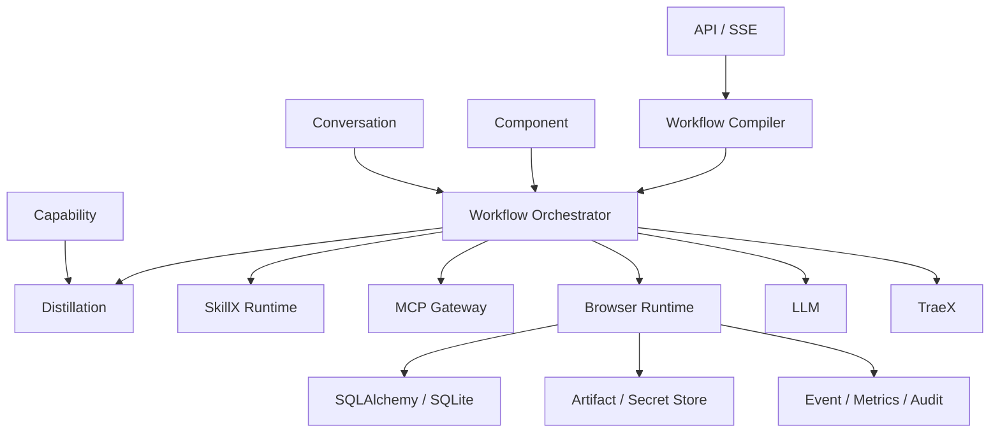

# SkillX 可视化工作流平台开发文档
工程结构、数据模型、接口契约与实施计划

| 文档版本 | v0.1                          |
|----------|-------------------------------|
| 文档状态 | 研发基线稿                    |
| 编制日期 | 2026-08-03                    |
| 适用范围 | SkillX / MCP 可视化工作流平台 |

**核心定位：首次任务由 Agent 探索，重复任务编译为持久化工作流；模型只在必要节点介入。**

# 目录

**1. 开发目标与工程约束**

**2. 仓库与模块组织**

**3. 本地环境与依赖管理**

**4. 领域模型与数据库设计**

**5. Workflow DSL 与编译器**

**6. 工作流调度器与 Worker**

**7. 节点执行器规范**

**8. SkillX 开发规范**

**9. MCP Gateway 开发规范**

**10. TraeX Adapter 与轨迹采集**

**11. 浏览器运行时与页面契约**

**12. 后端 API 与事件协议**

**13. 前端工程设计**

**14. 安全与运行隔离**

**15. 日志、指标和审计**

**16. 测试策略与质量门禁**

**17. 部署、迁移与运维**

**18. 开发阶段拆解与验收**

**19. 默认决策与待确认项**

# 1. 开发目标与工程约束

本文将设计文档转换为可执行的研发基线，明确代码模块、数据结构、接口、运行时协议、测试门禁和开发顺序。研发过程中出现实现选择冲突时，以以下约束为优先级。

- Workflow Orchestrator 是唯一的持久化总调度器；TraeX 不得承担已发布工作流的全程控制。

- 所有工作流可调用节点必须有机器可校验的输入输出契约。

- Direct 节点在没有模型配置时仍应运行；禁止隐式降级或升级执行模式。

- 长任务状态保存在数据库，API 进程、浏览器会话或 Worker 内存不能成为唯一事实来源。

- 有副作用的操作必须关联用户确认、授权快照和审计事件。

- 第一阶段采用模块化单体，不提前拆微服务；外部框架通过 Adapter 隔离。

| **研发基线**                                                                                                                                                      |
|-------------------------------------------------------------------------------------------------------------------------------------------------------------------|
| Python 3.12、FastAPI、Pydantic v2、SQLAlchemy 2、Alembic、SQLite WAL、React + TypeScript + Vite、独立 Worker、SSE。TraeX 和浏览器框架通过接口适配，不进入领域层。 |

# 2. 仓库与模块组织



*图 1 模块依赖与运行时适配器边界*

## 2.1 单仓库结构

```text
repository/
├── backend/
│   ├── app/
│   │   ├── api/
│   │   ├── domain/
│   │   │   ├── conversation/
│   │   │   ├── capability/
│   │   │   ├── workflow/
│   │   │   ├── component/
│   │   │   └── run/
│   │   ├── application/
│   │   │   ├── compiler/
│   │   │   ├── orchestrator/
│   │   │   ├── distillation/
│   │   │   └── publishing/
│   │   ├── runtime/
│   │   │   ├── nodes/
│   │   │   ├── skillx/
│   │   │   ├── mcp/
│   │   │   ├── browser/
│   │   │   └── traex/
│   │   └── infrastructure/
│   │       ├── database/ events/ artifacts/ secrets/
│   ├── migrations/
│   ├── tests/
│   └── pyproject.toml
├── frontend/
│   ├── src/
│   │   ├── app/ pages/ features/ entities/ shared/
│   │   └── generated/
│   └── package.json
├── capabilities/
│   ├── skillx/
│   └── mcp/
├── examples/
└── docs/
```

## 2.2 依赖规则

- domain 不依赖 FastAPI、SQLAlchemy、TraeX、Playwright 或 MCP SDK。

- application 依赖领域接口，组织用例和事务；runtime/infrastructure 实现接口。

- api 只负责认证、校验、DTO 转换和调用 application，不直接编写调度逻辑。

- NodeExecutor 通过注册表加载，新增节点类型不修改 Orchestrator 主循环。

- 前端页面不直接访问底层 fetch，统一通过生成的 API Client 和 feature 层调用。

# 3. 本地环境与依赖管理

## 3.1 Python venv

```text
python3.12 -m venv .venv
source .venv/bin/activate
python -m pip install --upgrade pip
pip install -e "backend[dev]"
alembic upgrade head
uvicorn app.main:app --reload --app-dir backend
python -m app.worker --app-dir backend
```

建议使用 pyproject.toml 管理依赖和工具配置。若团队统一采用 uv，可以用 uv 创建和同步 venv，但运行环境仍表现为标准 Python venv。

## 3.2 前端

```text
cd frontend
npm install
npm run dev
npm run typecheck
npm run test
npm run build
```

## 3.3 配置分层

| **配置层**        | **示例**                        | **存储方式**             |
|-------------------|---------------------------------|--------------------------|
| 静态默认          | 端口、日志格式、默认超时        | 代码与配置文件           |
| 环境配置          | 数据库路径、Artifact 根目录     | 环境变量                 |
| Secret            | API Key、OAuth Client Secret    | Secret Store，只保存引用 |
| Execution Profile | 模型、Token、工作目录和网络策略 | 数据库版本化记录         |

# 4. 领域模型与数据库设计

## 4.1 数据库原则

- SQLite 开启 WAL、foreign_keys、busy_timeout；写事务保持短小。

- 工作流定义和能力清单使用 JSON 文档存储，运行索引和状态使用结构化列。

- 大文件、轨迹和截图保存到 Artifact Store，数据库只保存 URI、哈希、大小和元数据。

- 所有时间统一存储 UTC，API 根据用户时区展示。

- 使用乐观版本号或 compare-and-set 防止多个 Worker 重复完成同一 NodeRun。

## 4.2 核心表

| **表**              | **关键字段**                                                           | **说明**                        |
|---------------------|------------------------------------------------------------------------|---------------------------------|
| conversations       | id, owner_id, title, bound_component_id, created_at                    | 持续对话及可见的组件上下文      |
| messages            | id, conversation_id, role, content_json, created_at                    | 用户、助手、Tool 卡片和系统消息 |
| conversation_runs   | id, conversation_id, status, traex_run_id, trace_artifact_id           | 一次动态 Agent 执行             |
| capabilities        | id, type, name, visibility, current_version_id                         | 能力逻辑标识                    |
| capability_versions | id, capability_id, version, manifest_json, digest, status              | SkillX/MCP/算子不可变版本       |
| workflows           | id, name, owner_id, draft_revision                                     | 工作流逻辑标识与草稿修订号      |
| workflow_versions   | id, workflow_id, version, definition_json, digest, validation_json     | 不可变发布版本                  |
| components          | id, name, workflow_id, default_version_id, visibility                  | 面向用户的组件                  |
| runs                | id, workflow_version_id, status, input_json, output_json, lease fields | 工作流执行实例                  |
| node_runs           | id, run_id, node_id, attempt, status, input/output, lease fields       | 节点执行与重试实例              |
| run_events          | id, run_id, node_run_id, seq, type, payload_json, created_at           | 有序事件流                      |
| approvals           | id, run_id, node_id, snapshot_digest, status, decided_by               | 确认与一次性授权                |
| artifacts           | id, run_id, kind, uri, sha256, size, metadata_json                     | 文件、截图、轨迹与报告          |
| secret_references   | id, provider, external_key, metadata_json                              | 不保存 Secret 明文              |

## 4.3 状态与并发控制

```text
# Worker 领取任务（概念 SQL）
UPDATE node_runs
SET status = 'running', worker_id = :worker,
    lease_expires_at = :lease, heartbeat_at = :now
WHERE id = (
  SELECT id FROM node_runs
  WHERE status IN ('ready', 'retry_waiting')
    AND available_at <= :now
  ORDER BY priority DESC, created_at
  LIMIT 1
)
AND status IN ('ready', 'retry_waiting');
```

- 每个 NodeRun 使用租约、心跳和 attempt 序号；租约到期后由恢复任务重新置为 ready 或 failed。

- 完成节点时校验 worker_id、attempt 和当前状态，防止过期 Worker 覆盖新结果。

- Run 状态由 Orchestrator 根据所有节点状态计算，不由单个 Executor 直接设置最终状态。

# 5. Workflow DSL 与编译器

## 5.1 DSL 顶层结构

```yaml
apiVersion: workflow.platform/v1
kind: Workflow
metadata:
  name: weather-query
spec:
  inputSchema: {...}
  uiSchema: {...}
  outputSchema: {...}
  nodes: [...]
  edges: [...]
  policies:
    maxDurationSeconds: 300
    maxParallelNodes: 4
```

## 5.2 节点公共字段

```json
{
  "id": "query_weather",
  "type": "skillx",
  "displayName": "查询天气",
  "input": {"city": "${input.city}"},
  "timeoutSeconds": 30,
  "retry": {"maxAttempts": 2, "backoffSeconds": 2},
  "execution": {"mode": "direct"},
  "onError": "fail_run",
  "permissions": ["network.weather-service"]
}
```

## 5.3 编译阶段

| **阶段** | **检查内容**                              | **输出**         |
|----------|-------------------------------------------|------------------|
| 语法解析 | 版本、字段、节点类型、表达式语法          | 规范化 AST       |
| 图检查   | ID 唯一、无非法环、可达性、终点           | 拓扑序与依赖表   |
| 契约检查 | 上游输出与下游输入、必填参数、Schema 兼容 | 类型诊断         |
| 能力解析 | 版本范围、接口、MCP Tool、权限            | 锁定能力快照     |
| 风险检查 | 副作用、重试、自动提交、fallback          | 风险报告与审批点 |
| 发布构建 | 计算 digest、生成不可变 JSON              | WorkflowVersion  |

## 5.4 表达式

- MVP 支持 `${input.x}`、`${node.output}`、`${node.output.y}`、JSONPath/JMESPath、字符串模板和有限布尔表达式。
- `${node.output}` 表示节点完整输出对象，`${node.output.y}` 表示其中字段；完整对象嵌入字符串时必须使用规范 JSON
  序列化，禁止依赖运行语言的对象转字符串结果。

- 表达式运行在受控解释器中，不允许 eval 或任意 Python。

- 编译时解析所有引用并计算依赖；运行时只传入当前节点所需数据。

# 6. 工作流调度器与 Worker

## 6.1 Orchestrator 主循环

```python
async def advance_run(run_id: str) -> None:
    run = await repo.lock_run(run_id)
    graph = await definitions.load(run.workflow_version_id)
    states = await repo.list_node_states(run_id)

    for node in graph.ready_nodes(states):
        inputs = resolver.resolve(node.input_mapping, run, states)
        await repo.create_ready_node_run(run_id, node, inputs)

    final = graph.evaluate_run_status(states)
    if final:
        await repo.finish_run(run_id, final)
```

- Orchestrator 只做状态推进和任务创建，不在数据库事务中执行外部调用。

- Worker 领取 NodeRun 后查找 NodeExecutor，执行并写入结果/事件，再触发下一次 advance_run。

- 取消通过 Run 的 cancellation_requested_at 传播；支持的 Executor 应尽快终止子进程、请求或浏览器动作。

- 等待用户或审批的节点释放 Worker，不占用进程。

## 6.2 重试策略

| **错误/节点**      | **默认策略**                             |
|--------------------|------------------------------------------|
| 网络读取、幂等 MCP | 指数退避重试                             |
| LLM 限流/暂时错误  | 有限重试并计入 Token/次数                |
| 输出 Schema 失败   | 允许一次修复提示；仍失败则终止           |
| 浏览器定位失败     | 按漂移策略进入 waiting_user 或局部 Agent |
| 写入/提交/发送     | 默认不自动重试；需要幂等键或人工确认     |
| 进程崩溃           | 租约恢复，按 attempt 上限处理            |

# 7. 节点执行器规范

## 7.1 统一接口

```python
class NodeExecutor(Protocol):
    node_type: str

    async def execute(
        self,
        context: RunContext,
        node: CompiledNode,
        inputs: dict[str, object],
    ) -> NodeResult: ...

    async def cancel(self, handle: ExecutionHandle) -> None: ...
```

## 7.2 NodeResult

```python
class NodeResult(BaseModel):
    status: Literal["succeeded", "waiting_user", "failed"]
    output: dict[str, object] | None = None
    artifacts: list[ArtifactRef] = []
    error: ExecutionError | None = None
    metrics: NodeMetrics = NodeMetrics()
    resume_token: str | None = None
```

## 7.3 执行器清单

| **执行器**           | **职责**                               | **关键要求**                    |
|----------------------|----------------------------------------|---------------------------------|
| MCPNodeExecutor      | 固定 Tool 调用                         | Schema、超时、权限、错误归一化  |
| SkillXDirectExecutor | 加载锁定能力版本并执行 Python/组合入口 | 独立 venv/工作目录、契约校验    |
| LLMNodeExecutor      | 一次结构化模型调用                     | 禁止自主 Tool；输出 JSON Schema |
| AgentNodeExecutor    | 调用 TraeX 完成局部动态任务            | Tool 白名单、步数、轨迹、取消   |
| BrowserNodeExecutor  | 页面动作、契约检查、漂移与提交         | 会话隔离、截图、确认授权        |
| OperatorExecutor     | 内置确定性转换                         | 纯函数、可复现、资源限制        |
| ApprovalExecutor     | 创建审批并暂停                         | 快照 digest、用户身份、过期策略 |
| ArtifactExecutor     | 保存文件/报告                          | 哈希、大小、内容类型、访问控制  |

# 8. SkillX 开发规范

## 8.1 skillx.yaml

SkillX 的唯一规范源为 [`skillx.md`](skillx.md)，当前版本固定为
`skillx.dev/v1alpha1`。Manifest 的接口统一位于 `spec.interfaces`，Guide 位于
`spec.guide`。工程文档不再复制另一套字段结构；实现、Fixture 和 Host 测试必须
直接按规范文档及 `capabilities/skillx/text-stats/skillx.yaml` 示例校验。

## 8.2 Python Direct 入口

```python
from skillx_sdk import SkillXContext, SkillXResult

async def execute(ctx: SkillXContext, inputs: dict) -> SkillXResult:
    city = inputs["city"]
    weather = await ctx.mcp.call("weather.get_current", {"city": city})
    return SkillXResult(output={
        "city": city,
        "condition": weather["condition"],
        "temperature": weather["temperature"],
    })
```

## 8.3 SDK 边界

- SkillXContext 只暴露声明过的 MCP、Secret Reference、Artifact 和日志接口。

- Direct 入口不得直接读取平台数据库或全局环境变量。

- 输出必须通过 SkillXResult 返回；文件通过 ctx.artifacts.create 注册。

- 执行前后分别校验 input/output Schema，记录能力 digest 与依赖版本。

## 8.4 测试

| **测试**        | **目的**                              |
|-----------------|---------------------------------------|
| manifest/schema | 清单和 Schema 可解析，字段与入口一致  |
| contract        | 正常、边界、非法输入和标准错误        |
| executor        | 使用 Fake MCP/Artifact 验证确定性逻辑 |
| permission      | 未声明能力不可访问                    |
| compatibility   | 版本升级不破坏已声明输出              |
| agent/llm       | 步数、Tool 白名单和输出结构           |

# 9. MCP Gateway 开发规范

- 维护 MCP Server 连接池和生命周期，第一阶段支持 STDIO 与 Streamable HTTP。

- 发现 Tool 后规范化名称、描述、Input Schema 和可选 Output Schema，并生成快照 digest。

- 调用前验证工作流绑定版本、调用方权限、参数和 Secret；调用后规范化错误、结果和指标。

- 禁止 Agent 直接读取 MCP 配置中的明文 Secret；由 Gateway 在传输层注入。

## 9.1 调用接口

```python
class MCPGateway(Protocol):
    async def discover(self, server_version_id: str) -> list[ToolDescriptor]: ...
    async def call(
        self,
        tool_snapshot_id: str,
        arguments: dict,
        context: CallContext,
    ) -> ToolCallResult: ...
```

## 9.2 Tool 元数据扩展

| **字段**            | **说明**                              |
|---------------------|---------------------------------------|
| idempotent          | 是否可安全重试                        |
| sideEffect          | none/read/write/delete/send/submit 等 |
| confirmationPolicy  | none/once/per_run/per_call            |
| timeoutSeconds      | 调用超时                              |
| retryableErrors     | 允许自动重试的标准错误                |
| requiredPermissions | 网络、业务域、身份范围                |

# 10. TraeX Adapter 与轨迹采集

## 10.1 适配接口

```python
class AgentRuntime(Protocol):
    async def start(self, request: AgentRunRequest) -> AgentRunHandle: ...
    async def events(self, handle: AgentRunHandle) -> AsyncIterator[AgentEvent]: ...
    async def cancel(self, handle: AgentRunHandle) -> None: ...
    async def result(self, handle: AgentRunHandle) -> AgentRunResult: ...
```

## 10.2 子进程实现基线

- 为每次运行创建独立工作目录和最小环境变量，生成临时 TraeX 配置。

- 通过子进程启动，捕获 stdout/stderr，并把可解析事件写入 RunEvent。

- 保存原始 trajectory 为 Artifact，再转换为平台统一的 AgentEvent。

- 取消时先发送优雅终止，超时后强制结束进程；状态必须映射为 cancelled 而不是普通失败。

## 10.3 轨迹标准化

| **事件**                     | **字段**                         |
|------------------------------|----------------------------------|
| agent.plan                   | 公开结构化计划，不保存私有推理   |
| agent.step.started/completed | 步骤 ID、类型、耗时、结果摘要    |
| tool.call.started/completed  | Tool、参数来源、结果摘要、错误   |
| browser.action               | URL、动作、定位器、截图 Artifact |
| artifact.created             | 类型、URI、哈希                  |
| agent.completed              | 结构化输出、Token、步骤数、状态  |

| **隐私要求**                                                                    |
|---------------------------------------------------------------------------------|
| 平台只保存可审计的行动摘要、Tool 调用和结果，不要求保存或展示模型的私有思维链。 |

生产 TraeX Adapter 必须在执行 Tool 前输出结构化 `agent.plan`。计划包含
`schemaVersion/planId/revision`，step 至少包含稳定 `id`、`action/capabilityRef`、
`dependsOn`、`argumentRefs`、`effect/idempotencyKey`、`outputName` 与 `fallback`。
后续 `tool.requested` 必须携带对应 `planStepId`。Host 校验能力、DAG、effect 和预算后，
将计划保存为不可变 PlanSnapshot Artifact；Agent 自报的 `retryable` 不能控制重试或接力。

在 continuation 中，Host accepted PlanSnapshot 是执行事实，不是提示词建议。Adapter 首个
`agent.plan` 必须与 Host 提供的 expected digest/revision/steps 完全一致；Tool request 还必须携带
plan digest、revision、step id 和 attempt。Host 根据严格 `argumentRefs`（literal、user_input、
step_output、artifact）物化参数，并核对 action、capability、effect、idempotency 与 arguments 后才调用
Adapter。

恢复入口只消费统一 `ContinuationRequest`，按冻结的 remaining DAG 执行。没有结构化计划时必须
返回 `replan_required`，不得从原始 prompt 静默重做并称为断点继续。改变 remaining plan 时必须
返回受类型约束的 ReplanPatch，绑定 source checkpoint、base plan digest/revision 和 step-state digest，
且只能替换 remaining closure；Host 在新步骤执行前持久化新的 PlanSnapshot revision。

`claimGeneration` 仅用于 checkpoint lease fencing，Worker reclaim 会增长该值；
`continuationGeneration` 是跨 ConversationRun 的业务接力链预算，只在创建下一代 continuation 时增长。

# 11. 浏览器运行时与页面契约

## 11.1 执行模型

- 推荐将确定性浏览器运行时建立在 Playwright 等可编程引擎上，TraeX/视觉 Agent 只用于首次探索和局部恢复。

- 每个 Run 使用隔离的 BrowserContext；登录状态通过受控 Session Profile 引用，不复制到日志。

- 每个动作产生 before/after 事件，关键步骤保存截图或 DOM 摘要。

## 11.2 PageContract

```python
class PageContract(BaseModel):
    page_id: str
    url_patterns: list[str]
    title_patterns: list[str] = []
    fields: list[FieldContract]
    submit: ElementContract | None = None
    success_assertions: list[AssertionSpec] = []
    fingerprint: str | None = None
```

## 11.3 漂移检测

- 定位器匹配之外还比较字段集合、required/type/options、关键文本、业务对象和当前身份。

- 检测器输出 drift_level、差异列表、候选元素及置信度；Executor 根据策略进入继续、等待用户、局部 Agent 或终止。

- 局部 Agent 修复只能返回建议的 ContractPatch；应用后生成新工作流草稿，不修改当前发布版本。

## 11.4 提交授权

```text
authorization_digest = sha256(canonical_json({
  "run_id": run_id,
  "page_fingerprint": current_page.fingerprint,
  "form_values": normalized_form_values,
  "identity": current_identity,
  "submit_action": submit_contract,
}))
```

提交前重新计算 digest。若与 Approval 保存的 snapshot_digest 不一致，节点必须回到 waiting_input_confirmation。

# 12. 后端 API 与事件协议

## 12.1 主要 REST API

| **资源**     | **接口**                                                                                              |
|--------------|-------------------------------------------------------------------------------------------------------|
| Conversation | POST /conversations；POST /conversations/{id}/messages；GET /runs/{id}/events/stream                  |
| Capability   | GET/POST /capabilities；POST /capabilities/{id}/versions；POST /versions/{id}/validate\|test\|publish |
| MCP          | POST /mcp-servers；POST /mcp-servers/{id}/discover；POST /mcp-tools/{id}/test                         |
| Workflow     | POST /workflows；PUT /workflows/{id}/draft；POST /validate\|test\|publish                             |
| Component    | GET /components；GET /components/{id}；POST /components/{id}/runs                                     |
| Run          | GET /runs/{id}；POST /runs/{id}/cancel；POST /runs/{id}/nodes/{node}/retry                            |
| Approval     | POST /approvals/{id}/approve；POST /approvals/{id}/reject                                             |
| Distillation | POST /conversation-runs/{id}/distill；GET /distillations/{id}                                         |

## 12.2 错误响应

```json
{
  "error": {
    "code": "WORKFLOW_VALIDATION_FAILED",
    "message": "工作流校验失败",
    "details": [{"path": "nodes[2].input.city", "reason": "missing source"}],
    "requestId": "req_xxx"
  }
}
```

## 12.3 SSE

```text
id: 1842
event: node.completed
data: {"runId":"run_x","nodeId":"query_weather","seq":1842,"payload":{...}}
```

- 客户端用 Last-Event-ID 重连；服务器按 seq 补发缺失事件。

- SSE 只传递摘要和 Artifact 引用，避免发送大文件或 Secret。

- 事件写入数据库成功后再推送，数据库是事件事实来源。

# 13. 前端工程设计

## 13.1 页面与路由

| **路由**              | **页面**                                 |
|-----------------------|------------------------------------------|
| /chat/:conversationId | 通用对话、运行轨迹和组件调用             |
| /components           | 组件列表和筛选                           |
| /components/:id       | 组件 DAG、表单、说明和历史               |
| /runs/:id             | 运行详情、节点状态、日志、Artifact、审批 |
| /workflows/:id/edit   | 可视化工作流编辑器                       |
| /capabilities/\*      | SkillX/MCP/算子管理                      |
| /settings/\*          | 模型、执行环境、Secret、权限和审计       |

## 13.2 状态管理

- 服务端状态使用查询缓存库管理；编辑器草稿使用本地 store，并通过 draft_revision 做并发保存。

- SSE 事件进入 RunEvent Store，根据 seq 去重并增量更新节点状态。

- 表单由 JSON Schema + UI Schema 生成；前后端使用同一 Schema 验证。

- 工作流图数据与运行状态分离，避免每个事件重新布局整个图。

## 13.3 DAG 编辑器组件

- NodePalette、WorkflowCanvas、NodeInspector、VariablePicker、ValidationPanel、VersionDiff。

- 节点端口来自编译器返回的 Schema 摘要；连接时进行即时兼容性提示。

- 业务视图通过 workflow_group 将多个技术节点聚合；技术视图可展开。

## 13.4 对话 UI

- 消息类型包括 text、artifact、tool_call、component_candidate、approval 和 error。

- 绑定组件上下文以显式横幅显示，用户可以退出；不能只保存在后端隐藏状态中。

- 执行轨迹抽屉只展示行动摘要，不展示私有推理。

# 14. 安全与运行隔离

## 14.1 身份与授权

- 所有 API 通过统一 AuthContext 获取 user、roles、organization 和 scopes。

- 发布、Secret、MCP 管理、代码能力开发和运行组件分别授权。

- 组件运行时根据用户身份与 WorkflowVersion 权限交集生成 EffectivePermission。

## 14.2 执行隔离

| **场景**      | **MVP 措施**                                    | **后续增强**           |
|---------------|-------------------------------------------------|------------------------|
| SkillX Python | 可信代码、独立工作目录、低权限 Worker、资源限制 | 容器/namespace/seccomp |
| TraeX         | 独立子进程、Tool/网络/目录白名单                | 独立执行节点或微虚机   |
| Browser       | 独立 Context、下载目录、Session Profile 权限    | 远程浏览器池           |
| MCP STDIO     | 固定命令白名单、最小环境变量                    | 独立代理进程           |

## 14.3 数据安全

- Secret 在日志、事件、异常和 Artifact 元数据中统一脱敏。

- Artifact 使用访问控制和不可猜测 URI；下载接口再次校验 Run/组织权限。

- 工作流输入输出字段可标记 sensitive，前端默认掩码并禁止全文事件推送。

# 15. 日志、指标和审计

| **类型** | **内容**                                                |
|----------|---------------------------------------------------------|
| 应用日志 | request_id、run_id、node_run_id、错误栈；不记录 Secret  |
| 运行事件 | 用户可见的状态、Tool、审批、Artifact 和结果摘要         |
| 指标     | 队列长度、租约过期、节点延迟、MCP/LLM/浏览器错误、Token |
| 审计     | 发布、权限、Secret 引用、审批、副作用调用和版本切换     |

## 15.1 核心事件

```text
run.created / run.started / run.completed / run.failed
node.ready / node.started / node.completed / node.failed
mcp.call.started / mcp.call.completed
llm.call.completed / agent.step.completed
browser.drift.detected / approval.requested / approval.resolved
artifact.created / workflow.version.published
```

# 16. 测试策略与质量门禁

## 16.1 测试金字塔

| **层级** | **覆盖**                                                         |
|----------|------------------------------------------------------------------|
| 单元测试 | 表达式、图算法、状态机、Schema 兼容、漂移分类、错误映射          |
| 组件测试 | 各 NodeExecutor 使用 Fake Adapter；数据库 Repository             |
| 契约测试 | SkillX、MCP Tool、API DTO、SSE 事件                              |
| 集成测试 | SQLite、Worker 租约、MCP 测试 Server、浏览器测试站点             |
| E2E      | 对话调用组件、固化草稿、零 LLM 天气、表单确认提交、局部 LLM 恢复 |
| 回归测试 | 历史 WorkflowVersion 和 SkillX fixtures                          |

## 16.2 必须通过的门禁

- 格式化、静态检查、类型检查和单元测试。

- 数据库迁移可从空库升级，且升级后核心查询通过。

- Direct E2E 在没有模型 Key 的环境中成功。

- 浏览器提交在缺少 Approval 时无法执行；数据变化会使授权失效。

- Direct SkillX 失败不会隐式调用 Agent。

- API/Worker 重启后 Run 与 NodeRun 状态可恢复。

# 17. 部署、迁移与运维

## 17.1 单机进程

```text
processes:
  api: uvicorn app.main:app
  worker-default: python -m app.worker --queue default
  worker-browser: python -m app.worker --queue browser
  frontend: static files served by reverse proxy
storage:
  sqlite: /var/lib/platform/platform.db
  artifacts: /var/lib/platform/artifacts
  capabilities: /var/lib/platform/capabilities
```

- 浏览器 Worker 可与普通 Worker 分开，减少浏览器崩溃和资源占用影响。

- 定期备份 SQLite 数据库、Artifact 元数据和能力仓库；备份前执行一致性检查。

- 迁移使用 Alembic；启动时只检查版本，不由多个进程并发自动执行迁移。

- 从 SQLite 升级 PostgreSQL 时，Repository 与锁/领取 SQL 使用数据库方言实现。

## 17.2 健康检查

| **检查**          | **判定**                                    |
|-------------------|---------------------------------------------|
| /health/live      | 进程事件循环正常                            |
| /health/ready     | 数据库可写、迁移版本正确、Artifact 目录可用 |
| Worker heartbeat  | 最近心跳和租约处理正常                      |
| Capability health | 关键 MCP 可连接，能力版本文件完整           |

# 18. 开发阶段拆解与验收

## 18.1 阶段 A：运行内核

- 领域模型、数据库迁移、Workflow DSL、编译器、Run/NodeRun 状态机。

- 独立 Worker、租约、SSE、Input/Transform/Condition/Output/Approval 执行器。

- 验收：纯确定性示例工作流可持久化运行、取消、失败和恢复。

## 18.2 阶段 B：能力运行时

- MCP Registry/Gateway、SkillX manifest/SDK/Direct Executor、LLM Executor。

- 验收：天气组件在无模型环境中仅输入城市即可完成；混合工作流只在指定节点产生 Token。

## 18.3 阶段 C：前端与组件

- 组件列表/详情、JSON Schema 表单、DAG 视图、运行详情和审批 UI。

- 工作流编辑器、变量选择、静态校验和版本发布。

- 验收：用户可创建、发布和运行组件，并查看完整节点状态。

## 18.4 阶段 D：对话与 TraeX

- 对话页、TraeX Adapter、轨迹事件、组件匹配与参数收集。

- 固化任务入口与轨迹归一化。

- 验收：首次 Agent 任务成功后生成工作流草稿，不直接发布。

## 18.5 阶段 E：浏览器固化

- Browser Executor、PageContract、漂移检测、确认快照和提交验证。

- 局部 Agent 恢复与 ContractPatch 草稿。

- 验收：固定网站表单在页面一致时零 LLM 重放；新增必填字段时禁止提交。

## 18.6 Definition of Done

- 代码、类型、测试、迁移、API 文档和用户可见错误均完成。

- 关键状态转换、权限和副作用具有自动化测试。

- 执行结果有可复核事件、日志和 Artifact，不以“看起来成功”代替验证。

- 变更不会破坏已发布版本或未显式升级的 SkillX/MCP 契约。

# 19. 默认决策与待确认项

## 19.1 已定默认决策

| **事项**       | **决定**                           |
|----------------|------------------------------------|
| 架构           | 模块化单体；API/Worker 分进程      |
| 工作流存储     | 不可变 JSON 定义 + 结构化运行表    |
| 实时协议       | SSE                                |
| Agent 集成     | TraeX 子进程 Adapter 起步          |
| Direct Runtime | Python、MCP 组合、内置算子         |
| 浏览器         | 确定性引擎为主，Agent 局部恢复     |
| 提交策略       | 用户确认后才允许提交；授权绑定快照 |
| 发布策略       | 能力和组件均需审核                 |

## 19.2 开工前需确认

- TraeX 的真实命令/API、配置格式、轨迹文件和取消语义。

- 前端 DAG 库、JSON Schema 表单库和后端 MCP SDK 的具体选型。

- 认证系统、用户/团队/组织模型和 Secret Provider。

- 第一批验收组件：建议至少包含天气查询、固定网站表单提交和一个局部 LLM 业务流程。

- 浏览器测试站点、登录态提供方式和允许保存的证据范围。
